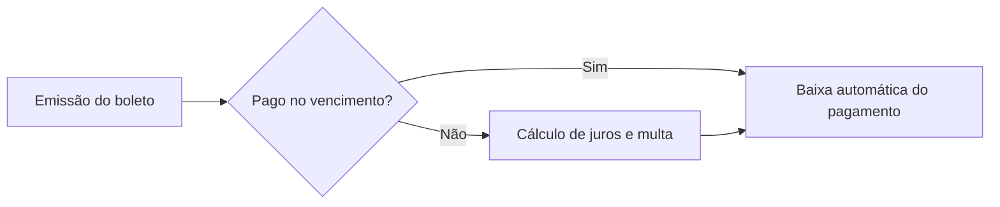
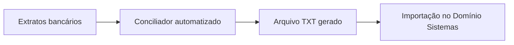
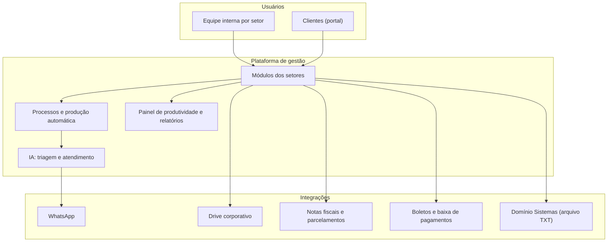

# Plataforma de Gestão Contábil: Estudo de Caso

Sistema web completo, projetado e desenvolvido **do zero** por [Albert Alves dos Santos](https://www.linkedin.com/in/albert-alves-dos-santos-780717197) para a operação da **Valentim Soluções Contábeis**. Ele reúne em um só lugar os setores do escritório (fiscal, contábil, departamento pessoal, financeiro, legalização, jurídico, comercial e administrativo), um portal exclusivo para clientes e automações apoiadas por IA.

> **Sobre este repositório:** o código-fonte é privado. Este é um estudo de caso público, com a visão geral do produto, dos fluxos e dos resultados, sem dados de clientes e sem detalhes que comprometam a segurança.

---

## Resultados

| Indicador | Resultado |
|---|---|
| Economia recorrente | **R$ 13,5 mil por mês** (equivalente a R$ 162 mil por ano) |
| Velocidade das entregas | **70% mais rápidas** |
| Operação dos setores | Fluxos operando de forma automatizada |
| Satisfação dos clientes | Crescente |
| Próxima etapa | Substituir o Domínio Sistemas por módulos próprios, com economia projetada de mais R$ 4 mil por mês (total de cerca de R$ 210 mil por ano) |

---

## O problema

A operação de um escritório contábil depende de muitas tarefas repetitivas e de setores que trabalham em sistemas e planilhas separados: abrir processos, cobrar documentos de clientes, conciliar extratos, emitir boletos, acompanhar prazos e atender solicitações. Isso consome mão de obra, atrasa entregas e dificulta enxergar o andamento do trabalho.

## A solução

Uma plataforma única que centraliza os setores, gera os processos de produção automaticamente, distribui documentos, cobra pendências dos clientes e usa IA para triar solicitações e atender pelo WhatsApp. O cliente acompanha tudo por um portal próprio.

---

## Módulos e funcionalidades

**Setores**
- Fiscal
- Contábil
- Departamento Pessoal
- Financeiro e BPO financeiro
- Legalização
- Jurídico (emissão de contratos)
- Comercial
- Marketing
- Administração
- Tecnologia

**Atendimento ao cliente**
- Portal exclusivo para clientes
- Solicitações dos clientes administradas por IA
- Atendimento via WhatsApp com IA, integrado ao suporte humano
- Onboarding de novos clientes
- Perícia e certificados digitais

**Automação e produtividade**
- Geração automática de processos para produção, com prazo de entrega
- Distribuição automática de documentos para os processos
- Cobrança automática de documentos dos clientes
- Calendário completo com feriados
- Painel de produtividade
- Relatórios internos e para clientes
- Chat interno
- Configuração central das integrações

**Financeiro e fiscal**
- Emissão de notas fiscais
- Busca automática das notas e dos parcelamentos dos clientes
- Emissão de boletos, com cobrança de juros e multa em caso de atraso
- Baixa automática de pagamentos
- Conciliação bancária automatizada, que gera o arquivo TXT pronto para importação no Domínio Sistemas

**Documentos**
- Integração com o drive corporativo, onde ficam guardados os arquivos enviados aos clientes, que são disponibilizados no portal

---

## Principais fluxos

### 1. Solicitação do cliente, triada por IA

O cliente registra uma solicitação, a IA identifica o setor responsável, e o sistema cria o processo com prazo de entrega.

### 2. Cobrança e baixa financeira

### 3. Conciliação bancária

### 4. Produção contábil

Os processos de produção são **gerados automaticamente**, e os documentos recebidos são **distribuídos de forma automática** para os processos correspondentes. Quando falta algo, o sistema faz a **cobrança automática** de documentos ao cliente.

---

## Visão geral da arquitetura

---

## Engenharia

Projeto desenvolvido de ponta a ponta:

- Arquitetura e organização do backend e do frontend
- Camadas de segurança aplicadas ao sistema
- Testes realizados
- Implantação em produção
- Automação dos fluxos operacionais

O desenvolvimento foi feito no **Replit**, com apoio de **Claude** e **Claude Code**, combinados a boas práticas de programação (organização de código, testes e segurança).

<!-- COMPLEMENTAR com o resumo técnico do Replit:
     - Stack (linguagens, frameworks, banco de dados, bibliotecas)
     - Hospedagem e deploy (ambiente, backups, monitoramento)
     - Tipos de teste e o que cobrem
     - Autenticação e controle de acesso por perfil (em nível geral)
     - Números do projeto (tabelas, rotas, módulos, telas)
-->

---

## Próximos passos

- Trazer para dentro da plataforma as funcionalidades do Domínio Sistemas, eliminando essa dependência e gerando economia adicional.
- Continuar automatizando fluxos dos setores e evoluindo os módulos.

---

## Autor

**Albert Alves dos Santos**: Engenheiro de Software e IA, estatístico (UEPB).
[LinkedIn](https://www.linkedin.com/in/albert-alves-dos-santos-780717197) · [GitHub](https://github.com/AlbertAlves12)
